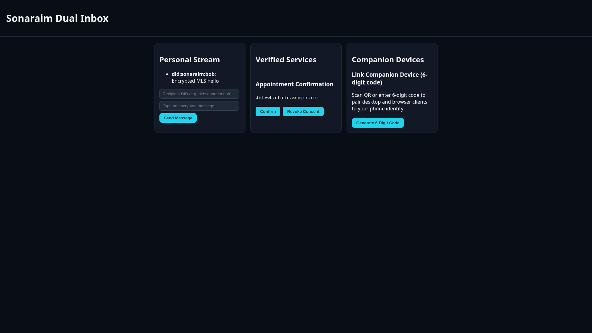
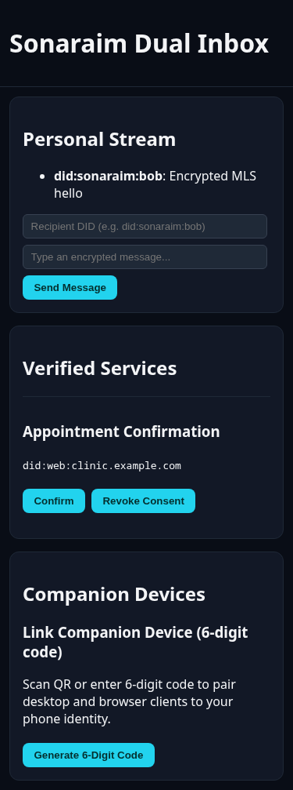
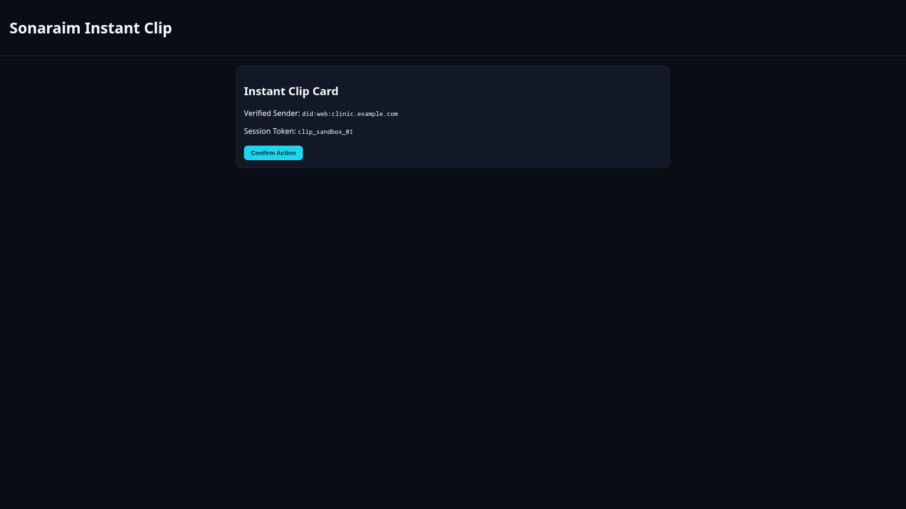
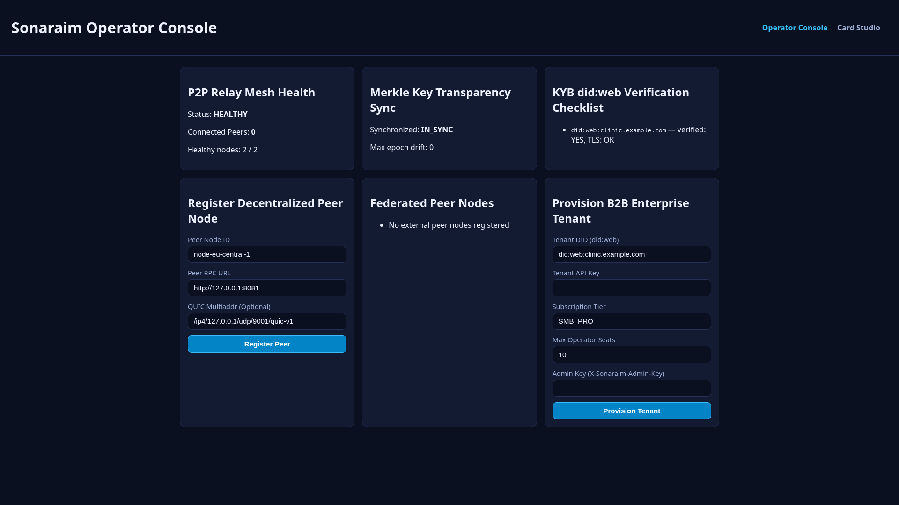
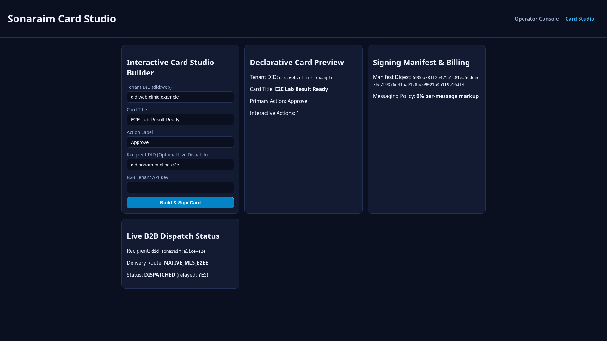

# Sonaraim

> Next-Generation Decentralized B2C Messaging & Verifiable B2B Transactional Ecosystem.

[](LICENSE)
[](SECURITY.md)
[](https://datatracker.ietf.org/doc/html/rfc9420)
[](#-core-architectural-pillars)
[](#-multi-service-ecosystem-architecture)

Sonaraim is an open, high-performance messaging and interactive commerce platform engineered to replace legacy centralized messengers and predatory per-message B2B toll gates. It combines a **Rust-powered decentralized P2P relay mesh (`libp2p` + QUIC + IETF MLS)** with a **developer-first Enterprise B2B Gateway**, **Zero-HTML Declarative Interactive Cards**, and **Passkey-backed Zero-Knowledge identity**.

---

## ⚡ Why Sonaraim?

To overcome the network effect of incumbent platforms like WhatsApp, Sonaraim delivers immediate, asymmetric value to both sides of the market:

### 📱 For End Users (B2C)

- **True Sovereignty & Metadata Privacy**: End-to-end encryption (IETF MLS RFC 9420) paired with **Sealed Sender** routing—relay nodes deliver encrypted envelopes to cryptographic mailboxes without knowing who is messaging whom.
- **Intelligent Dual Inbox (Personal vs. Services)**: Native separation from day one between **Personal Chats** (family, friends, private groups) and **Verified Service Channels** (banks, healthcare clinics, deliveries, invoices). Zero commercial clutter in personal spaces, with one-tap cryptographic consent revocation.
- **Zero-Redirect Actionable Chat (`Sonaraim Cards`)**: Instead of slow external web links or insecure HTML WebViews, verified businesses send native, cryptographically signed declarative cards directly inside the conversation—live delivery tracking, interactive seat selection, shopping carts, appointment booking, and one-tap payments.
- **Frictionless Portable Identity**: Instant onboarding via **Passkeys (WebAuthn PRF)** backed by a cross-platform **Zero-Knowledge Encrypted Vault**. Users never manage raw seed phrases and never lose encrypted history when switching between iOS and Android.

### 💳 For Businesses & Developers (B2B)

- **End of the "Per-Message Tax"**: Predictable flat-rate SaaS capacity pricing per seat or node capacity—no arbitrary per-template fees for OTPs, utility alerts, or transactional notifications.
- **Toll-Free AI & Native CRM Orchestration**: Connect custom AI agents and existing CRMs (Chatwoot, Zendesk, HubSpot, Salesforce) via low-latency gRPC and signed Webhooks with zero token markups or commercial content lock-in.
- **Cryptographic Brand Verification (`did:sonaraim` & `did:web`)**: Unforgeable enterprise identity backed by a distributed **Key Transparency Merkle Log** and DNSSEC/Ed25519 certificates, eliminating brand impersonation and phishing.
- **1-Click WhatsApp Cloud API Migration + Smart Fallback**: Drop-in translation layer for existing Meta Cloud API templates and webhooks, combined with **Instant Web / App Clip Cards** so 100% of customers can interact with rich notifications on day one—even before installing the native mobile app.

---

## 📸 Screenshots

| Dual Inbox (Desktop Interface) | Dual Inbox (Mobile App Experience) |
| :---: | :---: |
|  |  |

| Instant Clip Smart Fallback | Admin Operator Telemetry Console | Admin Visual Card Studio |
| :---: | :---: | :---: |
|  |  |  |

---

## 🌐 Multi-Service Ecosystem Architecture

This repository (`sonaraim`) serves as the **Coordinator / Control Repository** for the Sonaraim ecosystem. It holds global architecture specifications, cross-service contracts, deployment orchestration, and shared schemas across all 6 modular services.

| Service Repository | Primary Stack | Responsibility |
| :--- | :--- | :--- |
| **[`sonaraim`](https://github.com/alfonsodg/sonaraim)** *(This Repo)* | Markdown, JSON Schema, Docker, Helm | Control repository: global architecture, card schemas, multi-service orchestration, Nginx templates, Prometheus alerts, and backup scripts. |
| **[`sonaraim-protocol`](https://github.com/alfonsodg/sonaraim-protocol)** | Protobuf, Rust, TypeScript, Go | Formal wire specifications, Sealed Sender envelopes, OpenMLS cryptographic wrappers, and `Sonaraim Card Spec` validator. |
| **[`sonaraim-node`](https://github.com/alfonsodg/sonaraim-node)** | Rust (`libp2p`, QUIC, OpenMLS) | Decentralized P2P/Federated core relay node, ephemeral store-and-forward queues, UDP gossip transport, and Key Transparency Merkle log. |
| **[`sonaraim-b2b`](https://github.com/alfonsodg/sonaraim-b2b)** | Rust / Go (gRPC, REST, PostgreSQL, Redis) | Enterprise E2EE Termination Bridge, WhatsApp Cloud API compatibility adapter, Signed Card Engine, Consent Gate, and Smart Fallback Engine. |
| **[`sonaraim-admin`](https://github.com/alfonsodg/sonaraim-admin)** | React, TypeScript, Vite, Node.js | Dual-console web app for **Node Operators** (mesh telemetry, Merkle sync, KYB) and **B2B Tenants** (seat quotas, visual Card Studio, webhooks). |
| **[`sonaraim-app`](https://github.com/alfonsodg/sonaraim-app)** | React Native (`sonaraim-app/mobile`), Expo/EAS, TypeScript, LiveKit | B2C Mobile (iOS & Android via Expo/EAS native builds), Desktop, and Instant Web client with Dual Inbox, WhatsApp-parity features (E2EE media, MLS groups, reactions/receipts, 24h status), declarative cards, and Passkey ZK Vault. |

---

## 🏗️ System Topology & Data Flow

The following ASCII diagram illustrates the interaction between end users, enterprise systems, edge infrastructure, and decentralized mesh nodes:

```text
+-----------------------------------------------------------------------------------+
|                           SONARAIM ECOSYSTEM TOPOLOGY                             |
+-----------------------------------------------------------------------------------+
|                                                                                   |
|  [B2C Mobile & Web Clients]                [Enterprise & B2B Backends]            |
|  - iOS & Android (React Native Expo 51)    - CRM Systems (Chatwoot, Zendesk, etc) |
|  - Desktop (Tauri) / PWA                   - AI Agents & Webhook Automations      |
|  - Dual Inbox (Personal vs Services)       - WhatsApp Cloud API Migration callers |
|            |                                              |                       |
|            | TLS / HTTPS                                  | REST / Webhooks       |
|            v                                              v                       |
|  +-----------------------------------------------------------------------------+  |
|  |                            EDGE REVERSE PROXY                               |  |
|  |             (Nginx + Certbot TLS + Rate Limiting + Health Router)           |  |
|  +-------------------------------------+---------------------------------------+  |
|                                        |                                          |
|                +-----------------------+----------------------+                   |
|                |                                              |                   |
|                v                                              v                   |
|  +---------------------------+              +----------------------------------+  |
|  |     sonaraim-node         |              |          sonaraim-b2b            |  |
|  |  (Core Relay & Ledger)    |              |     (Enterprise E2EE Bridge)     |  |
|  |                           |  Submits     |                                  |  |
|  | * libp2p + QUIC Mesh      |<-------------| * WhatsApp Cloud API Adapter     |  |
|  | * Ephemeral Sealed Queues |  Envelopes   | * Cryptographic Consent Gate     |  |
|  | * Key Transparency Merkle |              | * Smart Fallback Engine          |  |
|  | * UDP Gossip Transport    |              | * Signed Card Generator          |  |
|  | * Blind PSI Discovery     |              | * Zero-Markup Billing Ledger     |  |
|  +-------------+-------------+              +-----------------+----------------+  |
|                ^                                              |                   |
|                |                                              |                   |
|                | Telemetry / Peer Mgmt                        | Dispatch / Quota  |
|                +-----------------------+----------------------+                   |
|                                        |                                          |
|                                        v                                          |
|                     +------------------------------------+                        |
|                     |          sonaraim-admin            |                        |
|                     |  (Dual-Console Web Application)    |                        |
|                     |                                    |                        |
|                     | * Node Operator Mesh Telemetry     |                        |
|                     | * Verifiable did:web KYB Auditor   |                        |
|                     | * Visual Sonaraim Card Studio      |                        |
|                     | * Tenant Quota & Key Rotation      |                        |
|                     +------------------------------------+                        |
|                                                                                   |
|  SHARED FOUNDATION:                                                               |
|  - sonaraim-protocol: RFC 9420 OpenMLS, Sealed Envelopes, Card Schemas            |
|  - configs/schemas: Strict 2020-12 Declarative Sonaraim Card validation           |
|  - deploy/compose: Multi-service container orchestration with zero-downtime       |
+-----------------------------------------------------------------------------------+
```

> [!NOTE]
> For interactive Mermaid sequence diagrams, group ratchet state transitions, and WebRTC calling topologies, see [docs/DIAGRAMS.md](docs/DIAGRAMS.md).

---

## 🔐 Core Architectural Pillars

1. **Dual-Plane Decentralization (Speed without Blockchain Bottlenecks)**:
   - **Data Plane (`sonaraim-node`)**: Real-time message routing runs over a `libp2p` QUIC/WebTransport mesh with sub-50ms latency, MLS group ratcheting, and S3-compatible client-encrypted blob storage. No message ever waits for blockchain block finality or pays per-message gas fees.
   - **Control Plane (Identity & Governance)**: Enterprise identities (`did:web` / `did:sonaraim`), public key packages, and revocation certificates are recorded in a verifiable **Merkle Tree Key Transparency Log** synchronized across validator nodes, with optional periodic state-root anchoring to low-cost L2 networks.
2. **Enterprise E2EE Termination Bridge**:
   - In B2C chats, encryption is strictly device-to-device. In B2B channels where support agents and stateless AI webhooks collaborate, the user encrypts against the verified organization's public key, and the organization's isolated **Enterprise Bridge** (`sonaraim-b2b` or sovereign on-premise node) terminates MLS and dispatches clean, signed JSON/gRPC payloads to internal systems.
3. **Cryptographic Consent & Anti-Spam Governance**:
   - Transactional and user-initiated service messages are unlimited under flat-rate plans. Proactive promotional campaigns require a **Cryptographic Consent Token** signed by the user's device, which can be revoked with a single swipe—enforced at the relay node level.
4. **Zero-HTML Native Declarative Cards (`Sonaraim Cards`)**:
   - Interactive experiences are defined via strict, cryptographically signed JSON schemas ([configs/schemas/sonaraim-card.schema.json](configs/schemas/sonaraim-card.schema.json)) and rendered using native OS primitives—eliminating WebView XSS, UI spoofing, and phishing vectors.
5. **Production Infrastructure & Observability**:
   - Edge reverse-proxy with system Nginx, TLS termination via Certbot, Prometheus service alerts (`configs/prometheus/alerts.yml`), and automated database/WAL volume backups (`deploy/scripts/backup-sonaraim.sh`).
6. **Milestone 14 WhatsApp-Parity Mobile Client & LiveKit SFU Calling**:
   - Fully featured sovereign mobile client in `sonaraim-app/mobile` built with React Native and Expo SDK 51, providing EAS native build automation (`eas.json`), client-side AES-256-GCM multimedia encryption, MLS ratcheted group messaging, emoji reactions, quote replies, typing indicators, delivery/read receipts, 24h ephemeral status/stories, and blind push token registration.
   - Optional dedicated LiveKit SFU service orchestrated via `docker compose --profile calls up -d` for end-to-end encrypted WebRTC audio and video calling rooms.

---

## 🧩 Repository Structure

```text
sonaraim/
├── configs/                # Shared service, reverse-proxy, and monitoring templates
│   ├── nginx/              # Nginx TLS reverse-proxy template (sonaraim.conf.template)
│   ├── prometheus/         # Prometheus alerting rules (alerts.yml)
│   └── schemas/            # Formal Sonaraim Card JSON Schema (2020-12)
├── debug/                  # Local debugging artifacts and screenshots (gitignored)
├── deploy/                 # Deployment orchestration manifests and scripts
│   ├── compose/            # Multi-service Docker Compose definitions
│   ├── helm/               # Kubernetes Helm chart templates
│   └── scripts/            # Automated backup script (backup-sonaraim.sh)
├── docs/                   # Comprehensive English documentation suite
│   ├── ARCHITECTURE.md     # System design, 6 services, and ASCII diagrams
│   ├── API.md              # B2B REST/gRPC API, WhatsApp adapter, and P2P RPC specs
│   ├── CONFIGURATION.md    # Environment variable and zero-hardcode config reference
│   ├── DEPLOYMENT.md       # Anti-destruction contract, DNS, and surgical updates
│   ├── DIAGRAMS.md         # Mermaid architecture, sequence, and state diagrams
│   ├── GLOSSARY.md         # Ubiquitous domain language and cryptographic terms
│   ├── INSTALL.md          # Setup, multi-repo checkout, and orchestration guide
│   └── STANDARDS.md        # Engineering, TDD, security, and git workflow standards
├── reference/              # Formal schemas (Sonaraim Card JSON Schema, OpenAPI, Proto)
├── samples/                # Sample environment files and interactive card payloads
├── src/                    # Coordinator validation scripts and contract runners
├── tests/                  # Cross-service integration and schema contract tests
├── CODE_OF_CONDUCT.md      # Contributor Covenant v2.1
├── CONTRIBUTING.md         # Development, TDD & git workflow guide
├── LICENSE                 # Apache License 2.0
├── REMOTE.md               # Deployment host coordinates (gitignored/untracked)
└── SECURITY.md             # Ecosystem security policy & zero-trust model
```

---

## 📄 Documentation Catalog

- **[Architecture Specification](docs/ARCHITECTURE.md)** — In-depth design of the 6 services, React Native mobile client, P2P MLS transport, Key Transparency log, and Enterprise E2EE Bridge.
- **[Ecosystem Comparison](docs/COMPARISON.md)** — Detailed comparison tables: Sonaraim vs. WhatsApp, Telegram, Signal, Matrix, Session, XMPP, and Slack/MS Teams.
- **[Visual Diagrams (Mermaid)](docs/DIAGRAMS.md)** — End-to-end topology, sequence, and state diagrams.
- **[API & Protocol Reference](docs/API.md)** — B2B Gateway endpoints, WhatsApp migration adapter, and Relay Node APIs.
- **[Configuration Guide](docs/CONFIGURATION.md)** — Complete environment variable catalog across all services and infrastructure components.
- **[Deployment & Anti-Destruction Contract](docs/DEPLOYMENT.md)** — Docker Compose orchestration, Nginx reverse proxy, Certbot TLS, Prometheus alerts, and backup procedures.
- **[Installation & Orchestration](docs/INSTALL.md)** — Local workstation setup, prerequisites, and quality gate commands.
- **[Engineering Standards](docs/STANDARDS.md)** — Mandatory coding, testing (TDD), security, and CI/CD rules.
- **[Domain Glossary](docs/GLOSSARY.md)** — Canonical definitions of domain, protocol, and cryptographic terminology.

---

## 📜 License

Licensed under the Apache License, Version 2.0. See [LICENSE](LICENSE) for details.

Copyright 2026 Sonaraim Contributors.
