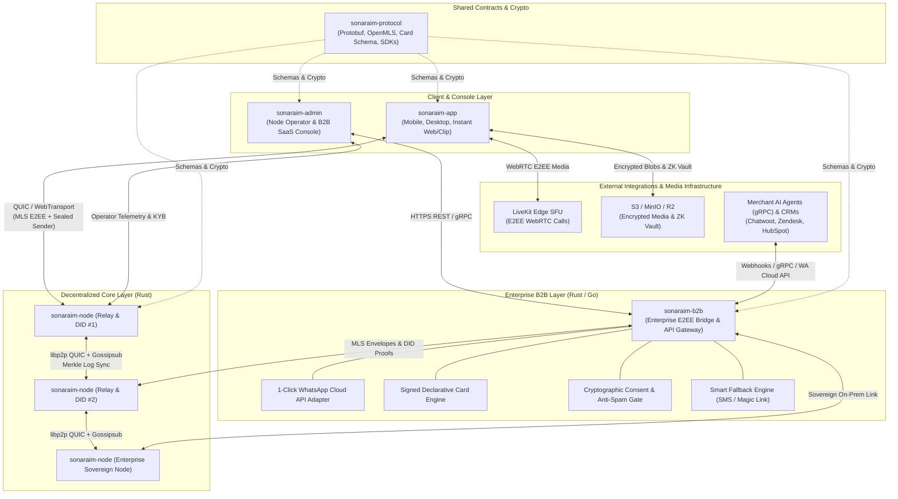
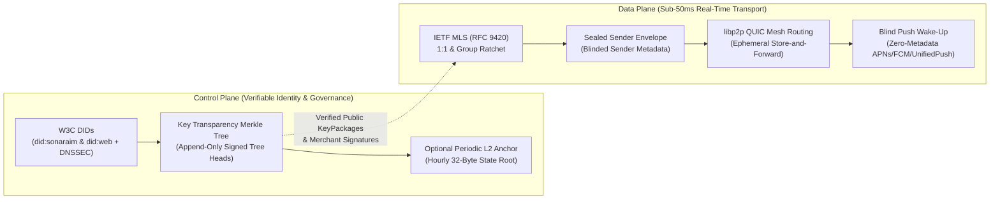
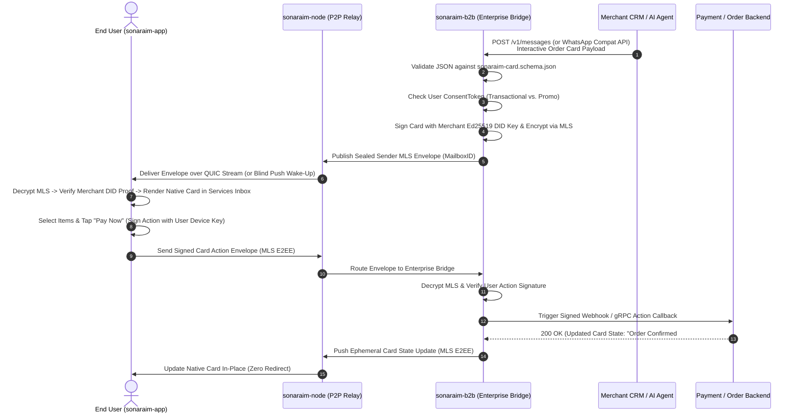
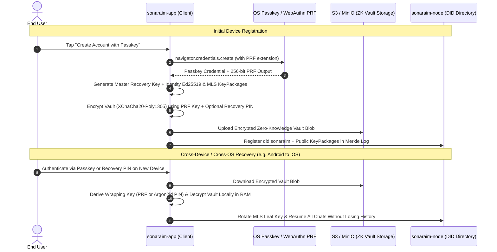
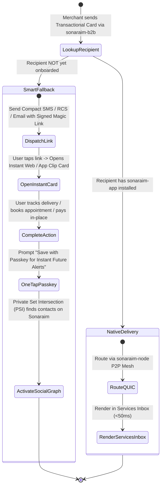

# System Architecture Diagrams (DIAGRAMS.md)

This document contains all Mermaid diagrams for the **Sonaraim** ecosystem. Architectural prose and ASCII representations are maintained in [docs/ARCHITECTURE.md](ARCHITECTURE.md).

---

## 1. Multi-Service Ecosystem Topology

---

## 2. Decentralized Data Plane vs. Control Plane

---

## 3. Enterprise B2B E2EE Bridge & Interactive Card Sequence

---

## 4. Passkey Onboarding & Cross-OS Zero-Knowledge Key Vault

---

## 5. B2B2C "Trojan Horse" Smart Fallback & Instant Onboarding Flow

